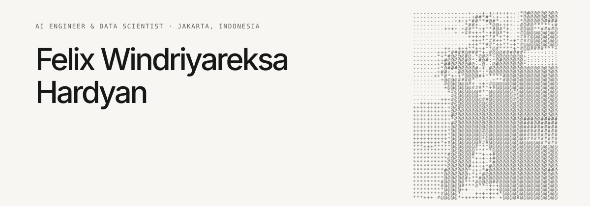
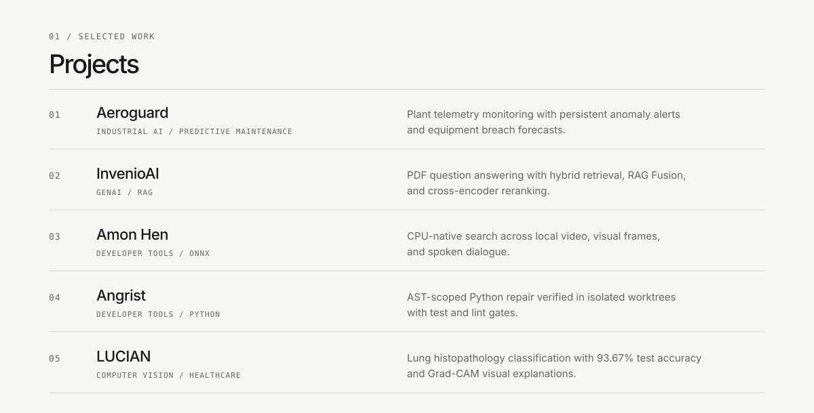
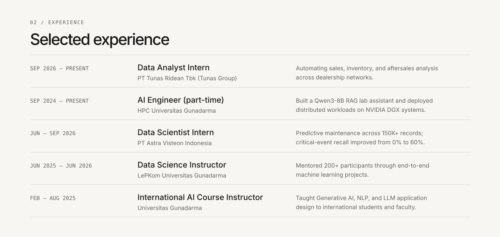

<table border="0" cellpadding="0" cellspacing="0" width="100%">
  <tr>
    <td width="76%" valign="middle" style="border:0; padding:0;">
      
    </td>
    <td width="24%" align="right" valign="middle" style="border:0; padding:0;">
      
    </td>
  </tr>
</table>

  
  &nbsp;&nbsp;&nbsp;&nbsp;
  
  &nbsp;&nbsp;&nbsp;&nbsp;
  
  &nbsp;&nbsp;&nbsp;&nbsp;
  
  &nbsp;&nbsp;&nbsp;&nbsp;
  

  

  

  

  

  <picture>
    <source media="(prefers-color-scheme: dark)" srcset="https://github-readme-streak-stats.herokuapp.com/?user=flxhrdyn&amp;hide_border=true&amp;background=101110&amp;border=343530&amp;ring=f1f0ec&amp;fire=f1f0ec&amp;currStreakNum=f1f0ec&amp;sideNums=f1f0ec&amp;currStreakLabel=aaa9a1&amp;sideLabels=aaa9a1&amp;dates=aaa9a1" />
    
  </picture>

